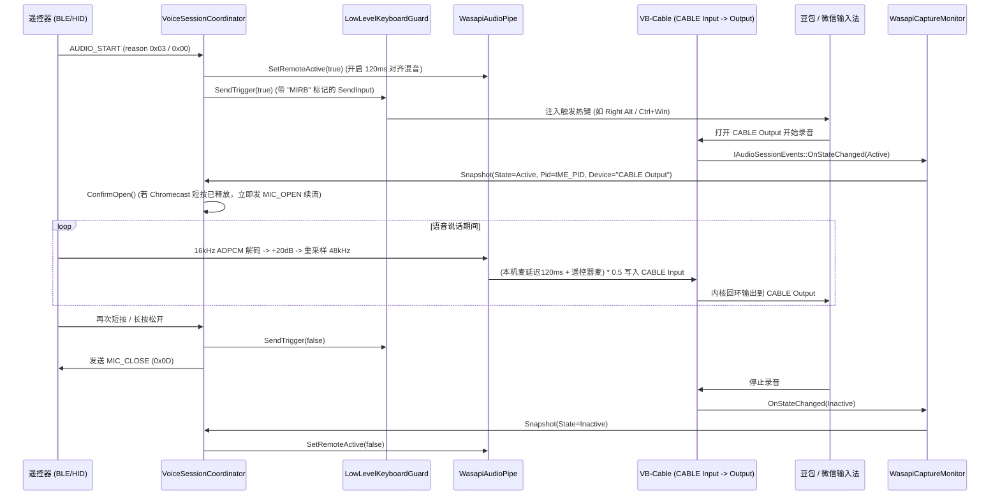
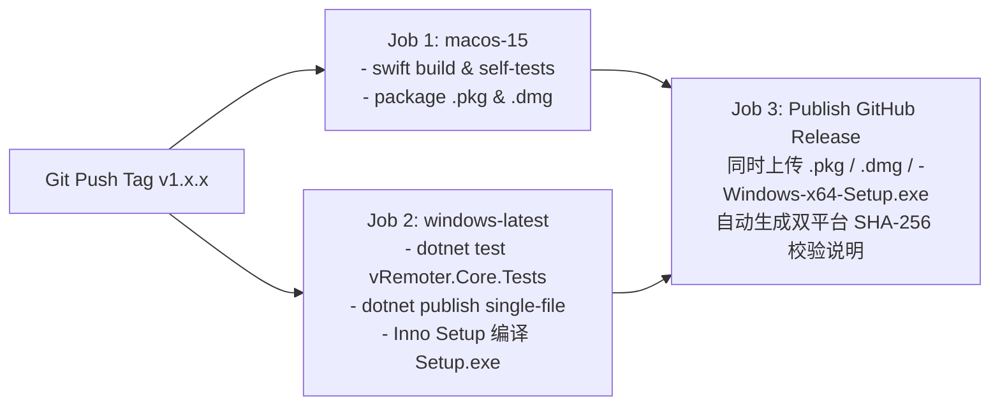

# vRemoter Windows 版：可行性论证、三大核心决策拍板与完备工程实施方案

## 1. 总体可行性与工程定调

**结论：100% 功能可行，且可通过「纯用户态核心 + 成熟 WHQL 签名虚拟声卡引导 + 同仓 Monorepo」实现零证书成本、高稳定性的生产级交付。**

针对 macOS 版 `vRemoter v1.4.0` 的全部功能（Chromecast / X6 双遥控器 BLE ATVV 语音识别、双路麦克风 120ms 对齐混音、豆包/微信输入法录音状态实时闭环监控、触发键分左右及点按/长按双模式、按键重映射、应用切换器、打开指定应用、切换应用输入框自动聚焦、30 秒交互式结构指纹绑定、GitHub Releases 自动更新），Windows 10/11 均具备原生对等或更优的底层 API。

---

## 2. 三大核心架构决策：深度调研与最优拍板

### 决策一：虚拟声卡策略 —— 拍板「VB-Cable 自动化引导安装 + 虚拟端点抽象层」

#### 调研排除过程
1. **排除“直接用 WASAPI 向虚拟麦克风写入”的误区**：Windows WASAPI 严格规定 `eCapture`（录音端点）只能创建 `IAudioCaptureClient` 读取，不能创建 `IAudioRenderClient` 写入。要把混音后的 PCM 喂给输入法，必须由**内核态音频驱动**将某个 `eRender`（播放端）的环形缓冲区内部回环（Loopback）拷贝到 `eCapture`（录音端）。
2. **排除 `VirtualDrivers/Virtual-Audio-Driver` 作为默认直通线**：该开源项目基于微软 `SYSVAD`，其虚拟扬声器与虚拟麦克风在驱动内默认是独立端点（主要用于 Sunshine 虚拟串流采集 WASAPI Loopback），并非开箱即用的内部硬连线 Render-to-Capture 回环线。
3. **排除 `Steam Streaming Microphone`**：虽有 Valve 的 WHQL 签名，但属于专有闭源驱动，易与用户本机 Steam Remote Play 冲突或被 Steam 客户端重置。
4. **验证 Windows 版豆包/微信输入法是否过滤虚拟声卡**：
   - macOS 版之所以要用 [Driver/build-driver.sh](file:///Users/jinjie/Documents/vRemoter/Driver/build-driver.sh) 把 BlackHole 的 `TransportType` 从 `'virt'` 二进制修改为 `'usb '`（USB），是因为 CoreAudio 暴露了 `kAudioDevicePropertyTransportType`，豆包 macOS 版据此隐藏了虚拟设备。
   - 而在 Windows WASAPI (`IMMDevice`) 中，虚拟声卡与物理声卡统一注册在 `KSCATEGORY_AUDIO` / `KSCATEGORY_CAPTURE` 下，**豆包输入法 Windows 版与微信输入法 Windows 版均不会隐藏虚拟麦克风**，可直接识别并选择 `CABLE Output (VB-Audio Virtual Cable)`。

#### 最优实施方案
- **默认首选驱动**：采用全球装机量超千万、拥有微软官方 WHQL 内核签名、支持 Win10/Win11（含 Secure Boot 与内核隔离 HVCI）的 **`VB-Cable`（VB-Audio Virtual Cable）**。
  - `WasapiAudioPipe` 向播放端 **`CABLE Input`** 持续写入 48kHz 双声道混音数据；
  - 驱动在内核态零延迟直通到录音端 **`CABLE Output`**，供豆包输入法或微信输入法采集。
- **合规的一键安装引导**：遵守 VB-Cable 授权规范（禁止修改签名二进制或未授权静默拆包），在 vRemoter 首次启动的「权限与环境引导」向导中内置**「一键下载并安装虚拟麦克风」**：
  - 自动从官方 CDN 下载驱动包、校验 SHA-256、解压至临时目录并调用 `VBCABLE_Setup_x64.exe` 引导用户一键确认安装，无需重启系统即可生效。
- **虚拟音频端点抽象层（`IVirtualAudioRoute`）**：
  - 按优先级自动探测匹配：
    1. `vRemoteDr Input` / `vRemoteDr Output`（预留未来基于 `SYSVAD` 修改 `MiniportWaveRT` 环形缓冲区的自研 WHQL 签名驱动，一旦日后申请 EV 证书即可无缝切换）；
    2. `CABLE Input` / `CABLE Output`（VB-Cable 默认匹配）；
    3. `VoiceMeeter Input` / `Line 1 (Virtual Audio Cable)` 等常见虚拟声卡，或用户在设置中手动指定的任意回环播放端。

---

### 决策二：HID 原生按键读取与屏蔽 —— 拍板「纯用户态三通道协同架构（零内核过滤驱动）」

#### 调研排除过程
1. **核实 macOS 版当前的真实水平**：
   查看现有源码 [ChromecastRemoteHIDBridge.swift](file:///Users/jinjie/Documents/vRemoter/Sources/vRemote/ChromecastRemoteHIDBridge.swift#L109-L120)、[X6HIDBridge.swift](file:///Users/jinjie/Documents/vRemoter/Sources/vRemote/X6HIDBridge.swift#L138-L150) 及 [README.md](file:///Users/jinjie/Documents/vRemoter/README.md#L22)：macOS 普通权限进程调用 `IOHIDManagerOpen(..., kIOHIDOptionsTypeSeizeDevice)` 会返回 `kIOReturnNotPrivileged`，**实际上在 macOS 上也是自动回退到共享模式（Shared Mode）+ `CGEventTap` 抑制搜索键**，用户体验依然非常顺畅。
2. **彻底排除捆绑 `HidHide` 或 `Interception` 内核驱动**：
   - `HidHide` 官方架构仅针对游戏控制器，**不支持隐藏走 `kbdhid.sys`（标准键盘）和 `mouhid.sys`（标准鼠标）的集合**，且卸载不当会导致 Windows 注册表 `UpperFilters` 损坏、开机主键盘失灵。
   - `oblitum/Interception` 虽然能按 VID/PID 拦截键盘，但需要重启电脑且容易与部分游戏反作弊系统（Vanguard / ACE）冲突。

#### 最优实施方案：纯用户态三通道协同
1. **通道 1：HID 原始报告直读（`HidCollectionReader`）**
   - 使用 `SetupDiGetClassDevs` + `HidD_GetAttributes` 枚举 `VID_18D1&PID_9450`（Chromecast）和 `VID_1D5A&PID_C081`（X6）的所有 HID 顶级集合（TLC）；
   - 对非系统独占的 Consumer / Vendor 集合，使用 `CreateFileW`（`FILE_SHARE_READ | FILE_SHARE_WRITE`）配合异步流直接读取原始 Input Report 字节（如 Chromecast 的 `Report ID 0x01` 和 X6 的 `0x02`/`0x03`/`0x5A`）。
2. **通道 2：Raw Input 后台全量监听（`RawInputMonitor`）**
   - 注册 `RegisterRawInputDevices`（`RIDEV_INPUTSINK`）覆盖 Keyboard (`0x01/0x06`)、Consumer (`0x0C/0x01`)、System Control (`0x01/0x80`)；
   - 在 `WM_INPUT` 中通过 `GetRawInputDeviceInfo` 精确匹配 `VID/PID`，捕获被 Windows `kbdhid.sys` 接管的 X6 键盘集合报告（如 `0xAA` 语音长按键、方向键、OK 键），并更新「遥控器按键活跃时间戳与门控状态」。
3. **通道 3：`WH_KEYBOARD_LL` 全局低级键盘钩子 + 动态门控（`LowLevelKeyboardGuard`）**
   - **合成事件标记防回环**：所有通过 `SendInput` 发出的按键均写入 `dwExtraInfo = 0x4D495242`（`"MIRB"`），钩子检测到该标记直接放行，不触发二次监听。
   - **物理触发键监听**：监听用户在主键盘按下的语音快捷键（支持单修饰键如 `Right Alt` 或组合键如 `Ctrl + Win`），通知 `VoiceSessionCoordinator` 协同开启遥控器麦克风。
   - **X6 原生搜索键与延迟修饰键 1.5s 门控抑制**：完全复刻 [X6SearchSuppressor.swift](file:///Users/jinjie/Documents/vRemoter/Sources/vRemote/X6SearchSuppressor.swift)，当通道 1/2 或 BLE 收到语音键边沿时，开启 1.5 秒门控，在 `WH_KEYBOARD_LL` 中精准吞掉 `VK_BROWSER_SEARCH` (`0xAA`) 及固件附带的干扰键。
   - **重映射按键冲突抑制**：对遥控器专属键（搜索、主页、返回、菜单、音量、媒体键）在 `WH_KEYBOARD_LL` 中按遥控器映射配置直接拦截并替换为目标动作；对于方向键/回车/ESC 等默认映射即自身的按键，保持原生低延迟响应。

---

### 决策三：代码仓库组织 —— 拍板「同仓库 Monorepo（`Windows/` 子目录）+ 双平台统一 Release」

#### 调研依据
1. **自动更新天然互不干扰**：
   现有 macOS 代码 [UpdateSupport.swift](file:///Users/jinjie/Documents/vRemoter/Sources/vRemote/UpdateSupport.swift#L47-L51) 严格通过 `.hasSuffix(".pkg")` 和 `.hasSuffix(".dmg")` 选择更新包。只要 Windows 构建产物命名为 `vRemoter-Community-<version>-Windows-x64-Setup.exe`（及 `.zip`），上传到同一个 GitHub Release 下，**macOS 客户端只下载 `.pkg`/`.dmg`，Windows 客户端只下载 `.exe`**，零冲突！
2. **协议、用例与版本号单一事实来源（Single Source of Truth）**：
   - 共用根目录 `VERSION`、[SelfTests/Fixtures/](file:///Users/jinjie/Documents/vRemoter/SelfTests/Fixtures) 和 [Resources/RemoteImages/](file:///Users/jinjie/Documents/vRemoter/Resources/RemoteImages) 遥控器高清矢量/位图资源；
   - 在 [.github/workflows/release.yml](file:///Users/jinjie/Documents/vRemoter/.github/workflows/release.yml) 中并行运行 `macos-15` 与 `windows-latest` 两个 Job，打一次 Tag 自动完成双端自测、打包与 Release 发布。

---

## 3. 同类成熟开源项目参考矩阵

开发 Windows 版各模块时，直接对照以下经过广泛验证的开源项目源码，可大幅降低踩坑概率：

| 核心模块 | 推荐参考的开源项目 | 借鉴的核心技术点 |
| --- | --- | --- |
| **ATVV BLE 语音协议与保活** | [`b0o/ATVVoice`](https://github.com/b0o/ATVVoice) (Rust)<br>本项目 [BLEBridge.swift](file:///Users/jinjie/Documents/vRemoter/Sources/vRemote/BLEBridge.swift) | ATVV v0.4/v1.0 状态机、`AB5E0001`~`0004` 订阅、ADPCM 解码、4s Keep-Alive 定时器、Chromecast 300ms 首帧静音看门狗 |
| **系统默认麦克风秒切 (`IPolicyConfig`)** | [`Belphemur/SoundSwitch`](https://github.com/Belphemur/SoundSwitch) (C#)<br>[`tartakynov/audioswitch`](https://github.com/audioswitch/audioswitch) | Undocumented `IPolicyConfig` COM 接口在 Win10/Win11 下的 GUID 定义与 `SetDefaultEndpoint` 跨版本兼容封装 |
| **WASAPI 采集、重采样与混音** | [`naudio/NAudio`](https://github.com/naudio/NAudio) (C#) | `WasapiCapture`、`WasapiOut`、`MMDeviceEnumerator`、低延迟环形缓冲与 IEEE Float 重采样 |
| **输入法进程录音状态监控** | [`File-New-Project/EarTrumpet`](https://github.com/File-New-Project/EarTrumpet) (C#/WPF) | `IAudioSessionManager2`、`IAudioSessionNotification`、`IAudioSessionControl2::GetProcessId` 的 COM 生命周期与线程安全管理 |
| **Windows UIA 树遍历与自动聚焦** | [`FlaUI/FlaUI`](https://github.com/FlaUI/FlaUI) (C#)<br>[`microsoft/accessibility-insights-windows`](https://github.com/microsoft/accessibility-insights-windows) | UIA3 (`CUIAutomation8`)、`IUIAutomationCacheRequest` 批量属性预取（防跨进程 COM 卡顿）、Electron/Chromium 无障碍树唤醒 |
| **蓝牙 HID 多集合读取与重连** | [`Ryochan7/DS4Windows`](https://github.com/Ryochan7/DS4Windows) (C#/WPF) | `SetupDiGetClassDevs` 枚举复合 HID 设备、`HidD_GetPreparsedData`、蓝牙休眠重连句柄清理与 `WM_INPUT` 协同 |

---

## 4. 完备工程架构与模块拆分规范（严格遵循单文件 ≤ 500 行）

> [!IMPORTANT]
> **代码行数与模块化铁律**：遵循全局规范，**所有 `.cs` 与 `.xaml` 文件严格控制在 500 行以内（目标 150–350 行/文件）**。针对 macOS 版中超过 500 行的巨型文件（如 `DebugWindowController.swift` 1935 行、`X6SessionCoordinator.swift` 1020 行、`BLEBridge.swift` 844 行），在 Windows 版中必须按单一职责拆分为细粒度子模块。

### 4.1 仓库目录结构设计

```text
vRemoter/
├── Package.swift                       # 现有 macOS 工程（保持不变）
├── Sources/vRemote/                    # 现有 macOS 源码（保持不变）
├── Resources/                          # 双端共享图片与引导资源
├── SelfTests/Fixtures/                 # 双端共享 JSON 测试夹具
└── Windows/                            # 新增 Windows 平台工程根目录
    ├── vRemoter.sln
    ├── Directory.Build.props           # 统一 net8.0-windows10.0.19041.0、Nullable、警告即错误
    ├── Installer/
    │   └── vRemoter.iss                # Inno Setup 安装包脚本（含 VB-Cable 检测与引导）
    ├── src/
    │   ├── vRemoter.Core/              # 纯逻辑与协议层（无 UI 依赖，100% 可单元测试）
    │   │   ├── Protocol/
    │   │   │   ├── AtvvTypes.cs                (~120 行) 版本、编解码枚举、控制事件定义
    │   │   │   ├── AtvvProtocol.cs             (~220 行) 能力解析、命令生成、音频帧解码调度
    │   │   │   └── ImaAdpcmDecoder.cs          (~130 行) 8k/16k IMA ADPCM 解码器
    │   │   ├── Session/
    │   │   │   ├── VoiceSessionState.cs        (~140 行) Phase/Owner/Gesture/Snapshot 定义
    │   │   │   ├── VoiceSessionCoordinator.cs  (~360 行) 核心状态机（打开/关闭/物理手势/外部激活）
    │   │   │   └── VoiceSessionWatchdogs.cs    (~240 行) 首帧静音看门狗、开麦重试、超时校验定时器
    │   │   ├── Focus/
    │   │   │   ├── IUiTreeBackend.cs           (~110 行) 跨平台 UI 树抽象接口（对应 AXTreeBackend）
    │   │   │   ├── InputFocusModels.cs         (~160 行) 状态枚举、AppEntry、配置快照模型
    │   │   │   ├── InputFocusLocator.cs        (~260 行) SHA-256 结构指纹构建与树解析器
    │   │   │   ├── InputFocusDiscovery.cs      (~280 行) 启发式聊天框识别与安全编辑区保护
    │   │   │   └── InputFocusBindingSession.cs (~180 行) 30 秒交互式绑定会话逻辑
    │   │   ├── Mapping/
    │   │   │   ├── RemoteProfiles.cs           (~180 行) Chromecast 与 X6 按键元数据定义
    │   │   │   ├── RemoteMappingModels.cs      (~160 行) MappingTarget 枚举、自定义快捷键与启动配置
    │   │   │   └── RemoteMappingStore.cs       (~220 行) 映射配置持久化与事件分发
    │   │   └── Updates/
    │   │       ├── AppVersion.cs               (~110 行) 语义化版本比较器
    │   │       └── GitHubUpdateService.cs      (~210 行) Release 查询、.exe 下载与 SHA-256 校验
    │   │
    │   └── vRemoter.Windows/           # Windows 平台驱动桥接与 WPF 界面层
    │       ├── Bluetooth/
    │       │   ├── BleDeviceWatcher.cs         (~220 行) 已配对 AEP 设备监控与自动重连策略
    │       │   ├── WinRtBleBridge.cs           (~340 行) ATVV GATT 读写、Notify 订阅与 PCM 回调
    │       │   └── WavRecorder.cs              (~140 行) 诊断录音 WAV 文件写入器
    │       ├── Audio/
    │       │   ├── VirtualAudioDetector.cs     (~190 行) VB-Cable / 虚拟声卡探测与一键安装引导
    │       │   ├── WasapiAudioPipe.cs          (~340 行) 本机麦采集 + 遥控器流输入 + 渲染调度
    │       │   ├── DualMicMixer.cs             (~210 行) 120ms 延迟对齐缓冲、线性重采样与等权混音
    │       │   ├── WasapiCaptureMonitor.cs     (~320 行) IAudioSessionManager2 输入法录音状态监控
    │       │   └── PolicyConfigRoute.cs        (~190 行) IPolicyConfig 默认录音设备切换与恢复
    │       ├── Input/
    │       │   ├── InputTriggerModels.cs       (~170 行) 左右修饰键、组合键、点按/长按模式定义
    │       │   ├── Win32SendInput.cs           (~230 行) 带 "MIRB" 标记的键盘/媒体键合成器
    │       │   ├── LowLevelKeyboardGuard.cs    (~250 行) WH_KEYBOARD_LL 物理触发监听与搜索键门控抑制
    │       │   ├── ChromecastHidBridge.cs      (~230 行) 18D1:9450 HID 报告读取与按键分发
    │       │   ├── X6HidBridge.cs              (~340 行) 1D5A:C081 报告解析、0xAA 长按判定与飞鼠
    │       │   └── AppSwitcherSession.cs       (~180 行) 切换应用会话、锁屏与睡眠系统调用
    │       ├── Focus/
    │       │   ├── WinUiaFocusBackend.cs       (~360 行) UIA3 (CUIAutomation8) + CacheRequest 实现
    │       │   ├── WinEventForegroundHook.cs   (~150 行) EVENT_SYSTEM_FOREGROUND 前台窗口切换钩子
    │       │   ├── InputFocusCoordinator.cs    (~350 行) 异步工作队列、切窗聚焦与语音前预聚焦
    │       │   └── AppLaunchService.cs         (~210 行) .exe/AUMID 启动、防闪烁置顶与聚焦衔接
    │       ├── System/
    │       │   ├── AppStorage.cs               (~180 行) JSON 配置存储（%LocalAppData%\vRemoter）
    │       │   ├── LaunchAtLogin.cs            (~160 行) 注册表 Run 与任务计划程序（可选高权限）自启
    │       │   ├── LogService.cs               (~150 行) 5MB 滚动日志记录器
    │       │   └── L10n.cs                     (~120 行) 中英双语切换支持
    │       └── UI/
    │           ├── TrayMenuController.cs       (~280 行) 系统托盘菜单与状态同步
    │           ├── Theme/ConsoleTheme.xaml     (~180 行) 暗色仪表盘配色与控件样式资源字典
    │           ├── Views/MainConsoleWindow.xaml(.cs)   (~320 行) 顶层导航与页面容器
    │           ├── Views/StudioMixerPage.xaml(.cs)     (~360 行) 混音器、电平表、触发键与输入法页
    │           ├── Views/RemoteMappingPage.xaml(.cs)   (~380 行) 遥控器图示与按键映射检查器页
    │           ├── Views/InputFocusPage.xaml(.cs)      (~360 行) 应用聚焦列表与 30s 交互绑定页
    │           ├── Views/AppLaunchPickerDialog.xaml(.cs)(~240 行) 打开指定应用选择器弹窗
    │           ├── Views/SetupGuideDialog.xaml(.cs)    (~280 行) VB-Cable、蓝牙与输入法分步引导弹窗
    │           └── Views/UpdateWindow.xaml(.cs)        (~300 行) 版本检查与更新下载弹窗
    └── tests/
        └── vRemoter.Core.Tests/        # xUnit 自动化测试工程
            ├── AtvvProtocolTests.cs            (~250 行) 1:1 移植 SelfTests/main.swift
            ├── VoiceSessionCoordinatorTests.cs (~380 行) 1:1 移植 VoiceSessionSelfTest.swift
            ├── InputFocusLocatorTests.cs       (~280 行) 1:1 移植 InputFocusSelfTest.swift
            └── UpdateServiceTests.cs           (~160 行) Fixtures 校验测试
```

---

## 5. 五大核心子系统程序设计规格

### 5.1 子系统一：BLE ATVV 语音采集（`WinRtBleBridge`）

1. **已配对设备监听与重连（解决 BLE HID 不广播问题）**：
   - 使用 `DeviceInformation.CreateWatcher(aqsFilter, requestedProperties, DeviceInformationKind.AssociationEndpoint)`；
   - `aqsFilter` 设为 `BluetoothLEDevice.GetDeviceSelectorFromPairingState(true)`，请求属性包含 `System.Devices.Aep.DeviceAddress` 与 `System.Devices.Aep.IsConnected`；
   - 当匹配的遥控器（名称包含 `X6-Remote` 或 `Chromecast Remote`，或匹配已存的 Bluetooth Address）变为 `IsConnected == true` 时，立即调用 `BluetoothLEDevice.FromIdAsync(info.Id)`。
2. **GATT 会话保活与特征订阅**：
   - 创建 `GattSession.FromDeviceIdAsync(bleDevice.BluetoothDeviceId)` 并设置 `MaintainConnection = true`；
   - 获取服务 `AB5E0001-5A21-4F05-BC7D-AF01F617B664`（使用 `BluetoothCacheMode.Uncached` 防止固件重连后句柄失效）；
   - 对 `AB5E0003`（Audio）、`AB5E0004`（Control）以及支持 Notify 的 `AB5E0002`（Command）调用 `WriteClientCharacteristicConfigurationDescriptorAsync(GattClientCharacteristicConfigurationDescriptorValue.Notify)`；
   - 订阅成功后立刻发送 `GetCapabilitiesCommand` (`[0x0A, 0x01, 0x00, 0x00, 0x03, 0x03]`)，并在首次连接时按 `resetSessionOnConnect` 发送一次 `MicCloseCommand(0)` 清理僵尸会话。

---

### 5.2 子系统二：WASAPI 双路混音与输入法状态监控（`WasapiAudioPipe` & `WasapiCaptureMonitor`）



1. **输入法进程识别清单（`VoiceInputMethod`）**：
   - **豆包输入法 Windows 版**：监控进程名集合 `["DoubaoIme", "DoubaoVoice", "DoubaoInput", "Doubao"]`（支持在配置文件中热扩展），用户在豆包语音设置中将麦克风选为 `CABLE Output (VB-Audio Virtual Cable)`；
   - **微信输入法 Windows 版**：监控进程名集合 `["WeType", "WeTypeVoice", "WeTypeService", "wxime"]`，选中微信输入法时，`PolicyConfigRoute` 自动通过 `IPolicyConfig::SetDefaultEndpoint` 将系统默认录音设备（`eConsole` 与 `eCommunications`）切换为 `CABLE Output`，退出时恢复原默认麦克风。
2. **输入法录音状态捕获（`WasapiCaptureMonitor`）**：
   - 对系统内所有 `DataFlow.Capture` 且 `DeviceState.Active` 的音频端点注册 `IAudioSessionManager2` 的 `IAudioSessionNotification`；
   - 当目标输入法进程的 Session 变为 `AudioSessionStateActive` 时，立即读取它绑定的 `IMMDevice.ID`：
     - 若绑定的不是虚拟麦克风（`CABLE Output`），在 UI 状态栏提示 `⚠️ 豆包正在录音，但实际麦克风不是虚拟音频线`；
     - 若绑定正确，触发 `VoiceSessionCoordinator.ConfirmOpen()`。

---

### 5.3 子系统三：触发键合成、HID 读取与 UIPI 穿透（`Input` 模块）

1. **Windows 触发键模型扩展（`InputTriggerModels.cs`）**：
   - **预设单键**（区分左右，扫描码 + 扩展键标志 `KEYEVENTF_EXTENDEDKEY`）：
     - `LeftAlt` (`VK_LMENU = 0xA4`), `RightAlt` (`VK_RMENU = 0xA5` — **豆包 Windows 版默认**)
     - `LeftControl` (`VK_LCONTROL = 0xA2`), `RightControl` (`VK_RCONTROL = 0xA3`)
     - `LeftShift` (`VK_LSHIFT = 0xA0`), `RightShift` (`VK_RSHIFT = 0xA1`)
     - `LeftWin` (`VK_LWIN = 0x5B`), `RightWin` (`VK_RWIN = 0x5C`)
   - **预设组合键**（适配微信输入法 Windows 版默认配置）：
     - `Ctrl + Win`（微信输入法默认「按住说话」）
     - `Ctrl + Win + Shift`（微信输入法默认「点按切换」）
     - 支持用户「录制任意触发快捷键」。
2. **系统级映射动作的 Windows 原生实现**：
   - `ShowDesktop`：合成 `Win + D`；
   - `Spotlight / Search`：合成 `Win + S`；
   - `Copy / Paste / Undo`：合成 `Ctrl + C` / `Ctrl + V` / `Ctrl + Z`；
   - `LockScreen`：直接 P/Invoke `user32.dll!LockWorkStation()`；
   - `Sleep`：调用 `powrprof.dll!SetSuspendState(false, false, false)`；
   - `AppSwitcher`：提供两种可切换实现：
     - 默认：**内置置顶暗色切换浮层（`OverlayAppSwitcher`）**，枚举当前桌面可见窗口，遥控器按切换键或左右方向键高亮目标应用，1 秒无操作自动调用穿透版 `SetForegroundWindow` 切过去（**完全不受 Windows UIPI 对原生 `Alt+Tab` 的拦截限制**）；
     - 备选：当以高权限运行时，可直接合成虚拟 `Alt` 按住 + `Tab` + 1 秒倒计时释放。
3. **UIPI（管理员窗口权限隔离）解决方案**：
   - 在 `LaunchAtLogin` 与设置页提供**「增强兼容模式（以管理员权限运行）」**开关：开启后通过 Windows 任务计划程序（`schtasks /create /rl HIGHEST /sc ONLOGON`）实现**开机静默高权限自启（无 UAC 弹窗）**，确保当用户前台是管理员权限运行的 IDE、终端或游戏时，语音触发键、按键映射和 UIA 自动聚焦依然 100% 生效。

---

### 5.4 子系统四：Windows UI Automation 输入框自动聚焦（`WinUiaFocusBackend`）

直接实现 `vRemoter.Core.Focus.IUiTreeBackend<IUIAutomationElement>` 接口，复用 `InputFocusLocator`、`InputFocusDiscovery` 与 `InputFocusBindingSession` 的全部核心算法：

1. **高性能批量缓存读取（避免跨进程 COM 阻塞）**：
   - 初始化 `CUIAutomation8`（UIA3），设置 `TransactionTimeout = 120ms`, `ConnectionTimeout = 80ms`；
   - 构建全局 `IUIAutomationCacheRequest`，一次性预取以下属性：
     - `UIA_ControlTypePropertyId`, `UIA_LocalizedControlTypePropertyId`
     - `UIA_AutomationIdPropertyId`, `UIA_ClassNamePropertyId`
     - `UIA_NamePropertyId`, `UIA_HelpTextPropertyId`
     - `UIA_IsEnabledPropertyId`, `UIA_IsOffscreenPropertyId`
     - `UIA_IsKeyboardFocusablePropertyId`, `UIA_HasKeyboardFocusPropertyId`
     - `UIA_IsPasswordPropertyId`, `UIA_BoundingRectanglePropertyId`
   - 遍历窗口子树时调用 `GetCachedChildren()` / `FindAllBuildCache()`，将 5000 个节点的遍历耗时控制在 **50–150ms** 以内。
2. **角色与安全规则映射**：
   - **可编辑候选角色**：`UIA_EditControlTypeId (50004)`、`UIA_DocumentControlTypeId (50030)`（Electron/Monaco/ProseMirror 富文本聊天框常暴露为 `Document` 或带可写 `ValuePattern`/`TextPattern` 的控件）、`UIA_ComboBoxControlTypeId (50003)`；
   - **排除与拦截角色**：`CurrentIsPassword == true`（密码框）、`UIA_MenuControlTypeId`、`UIA_MenuItemControlTypeId`、`UIA_WindowControlTypeId`（且 `WindowPattern.CurrentIsModal == 1` 时判定为模态弹窗阻塞，不抢焦点）；
   - **聊天框高置信度匹配**：复用现有的 `chatIdentifiers`（`prompt-textarea`, `chat-input`, `composer-input` 等）与中英文 `chatHintPhrases`（`输入消息`, `发消息`, `ask anything`, `type a message` 等），同时匹配 `AutomationId`、`ClassName`、`Name` 和 `HelpText`。
3. **打开指定应用与防闪烁置顶（`AppLaunchService`）**：
   - 支持用户从「当前运行中的应用列表」一键点选，或浏览选择 `.exe` / `.lnk` 快捷方式；
   - 触发按键时：若目标进程已运行且有主窗口，使用 `AttachThreadInput` + `ShowWindow(hWnd, SW_RESTORE)` + `SetForegroundWindow(hWnd)` 将窗口可靠拉到前台（不会只闪任务栏），随后立即触发 `InputFocusCoordinator.RequestPostLaunchFocus()` 将光标切入输入框。

---

## 6. CI/CD 构建与跨平台发布方案

修改 [.github/workflows/release.yml](file:///Users/jinjie/Documents/vRemoter/.github/workflows/release.yml)，新增 Windows 自动构建与打包 Job：



- **Windows 构建命令**：
  ```powershell
  dotnet test Windows/vRemoter.sln -c Release
  dotnet publish Windows/src/vRemoter.Windows/vRemoter.Windows.csproj `
    -c Release -r win-x64 --self-contained true `
    -p:PublishSingleFile=true -p:IncludeNativeLibrariesForSelfExtract=true `
    -o Windows/dist/publish
  iscc /DMyAppVersion="$VERSION" Windows/Installer/vRemoter.iss
  ```
- **产物命名**：`vRemoter-Community-${VERSION}-Windows-x64-Setup.exe` 与 `vRemoter-Community-${VERSION}-Windows-x64-Portable.zip`。

---

## 7. 分阶段实施与验证计划

| 阶段 | 周期 | 核心交付物 | 验收标准（Definition of Done） |
| --- | --- | --- | --- |
| **Phase 1：Core 移植与自动化单测** | 第 1 周 | `vRemoter.Core` + `vRemoter.Core.Tests` | `ATVV` 协议、`ADPCM` 解码、`VoiceSessionCoordinator`、`InputFocusLocator/Discovery`、`GitHubUpdateService` 全部单测 100% 通过，所有文件 ≤ 500 行 |
| **Phase 2：蓝牙、音频与输入法闭环** | 第 2 周 | `Bluetooth/` + `Audio/` + `Input/` | Windows 11 真机连上 Chromecast / X6 遥控器，按下语音键能驱动豆包输入法 / 微信输入法开始语音输入，双麦混音清晰，松开或再按准确停止 |
| **Phase 3：按键映射与 UIA 自动聚焦** | 第 3 周 | `ChromecastHidBridge` + `X6HidBridge` + `WinUiaFocusBackend` | 遥控器各按键映射、应用切换浮层、打开指定应用、切回微信/Antigravity/AI 客户端自动聚焦输入框 + 30 秒交互绑定全部跑通 |
| **Phase 4：WPF 界面、安装器与 CI 发布** | 第 4 周 | `UI/` + `vRemoter.iss` + `.github/workflows/release.yml` | 完整复刻暗色仪表盘 UI、VB-Cable 一键安装引导、系统托盘与开机自启，GitHub Actions 自动产出双端 Release 安装包 |
